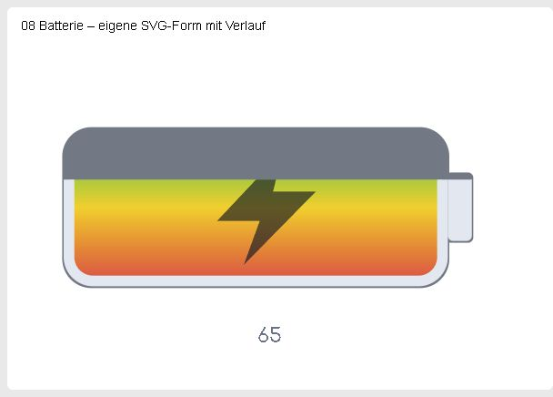

# EChartsProgress

Stellt einen aktuellen Zahlenwert als Pfadfortschritt oder gefüllte Form in
einer nativen Symcon-Kachel und optional in IPSView dar. Das Modul übernimmt
JSLive-Progressbar-Modelle. Für wiederholte Symbolbalken mit mehreren Quellen
verwenden Sie [EChartsPictorialBar](../EChartsPictorialBar/README.md).



Aufnahme einer übernommenen JSLive-Testinstanz aus der nativen Kachelausgabe.
Die Farben und die Form stammen aus dem geprüften Importmodell.

Voraussetzungen und Installation: [SymconECharts](../README.md#voraussetzungen)
(IP-Symcon 9.0/9.1, PHP 8.5, gemeinsames Gateway).
Alle technischen Felder, Standardwerte und Quellenparameter stehen in der
[Konfigurationsreferenz](../docs/KONFIGURATION.md#echartsprogress).

## Einrichtung

1. Im gemeinsamen [EChartsGateway](../EChartsGateway/README.md) das JSLive-
   Exportpaket auswählen und die vollständige Übernahme vorbereiten.
2. Quelle, Wertebereich, Form und einzeln aufgeführte Unterschiede prüfen.
3. Die Neuanlage ausdrücklich bestätigen. Die ursprüngliche Instanz und ihre
   Quellvariable bleiben erhalten.
4. In der neuen Instanz Titel und Kachel-/IPSView-Anpassungen einstellen.

Eine leere, manuell angelegte Instanz besitzt noch kein Fortschrittsmodell.
Diese Version wird über die bestätigte JSLive-Übernahme eingerichtet.

## Wertebereich und Formen

Der Export liefert Minimal-/Maximalwert, Rundung, Schrittweite, Farben und
Form. Auch umgekehrte Bereiche bleiben erhalten. Die Füllung wird an den
Bereich begrenzt; der Originalwert samt nativer Formatierung bleibt erhalten.
Bei Strichformen entspricht die farbige Strecke dem Anteil an der gesamten
Pfadlänge, auch bei mehreren Bögen und eigenen Strichmustern.
Es wird genau eine numerische Quellvariable gelesen. Quellen, Darstellungen,
Actions und Archivierung werden nicht verändert. Legacy-Profile sind nach der
Übernahme nicht erforderlich.

Unterstützt werden die geprüften Standardformen, eigene SVG-Pfade und sichere
SVG-Füllformen aus dem Export. Aktive SVG-Inhalte, fremde Skripte, eigene
ausführbare Vorlagen und ungeprüfte Bild-/Farbeffekte werden abgewiesen. Eine
Zustimmung zu Designabweichungen hebt solche Sperren nicht auf.

SVG-Füllformen behalten ihre eigenen Farben, Verläufe und Transparenzen. Die
Füllfarbe färbt diese Bilder nicht um; der Wert bestimmt den sichtbaren
Ausschnitt. Auch die Textvorlage behält ihre ursprüngliche schwarze Schrift.
Die separate Hintergrundfarbe und ihre Verbreiterung bleiben wirksam.

### Verlaufsfarben und SVG-Füllbilder aus JSLive

Zusätzlich werden die JSLive-Felder `override_fill`, `override_stroke` und
`fill_backgroundFile` übernommen. Unterstützt sind explizite Hex-Farben,
SVG-Bilder als Base64-Daten-URI in den Overrides und
`data:ldbar/res,gradient(Winkel,Dauer,Farbe,...)`
mit zwei bis 16 Hex-Farben, Winkel 0–360° und Dauer 0–3600 Sekunden. Der
Verlauf bewegt die wiederholte Palette mit der ursprünglichen Richtung und Dauer.
Eine Dauer von null oder ausgeschaltete Zielanimationen ergeben ein Standbild.
Aktualisierungen und Größenänderungen behalten die Phase; getrennte Dokumente
starten unabhängig. Der Importbericht benennt Unterschiede im Browser-Timing.
Die Bewegung wird lokal und begrenzt gezeichnet, ohne alte Skripte auszuführen.

Die Zahlenbeschriftung folgt der Quellvorlage: Präfix und Suffix stammen nur
aus dem ursprünglichen Standardprofil, nicht aus einer nativen Darstellung
oder einem benutzerdefinierten Profil. Neue Importe frieren diese Texte
profilunabhängig ein. Bei älteren Importmodellen werden sie ausschließlich
lesend aus der Quellvariable aufgelöst, ohne die Konfiguration zu ändern.
Der Tooltip behält die vollständige native Formatierung mit Originaleinheit.

Das SVG-Füllbild muss als `image/svg+xml` eingebettet sein; ein explizites
`override_fill` hat Vorrang. Eigene SVG-Formen behalten weiterhin ihre eigenen
Farben. Die Bildgröße und Musterperiode folgen der Quelle und ändern sich
nicht mit dem Wert. Die Rasterauflösung passt sich dem verfügbaren Platz und
der Pixeldichte an, innerhalb von maximal 4096 × 4096 Bildpixeln.

SVG-Muster dürfen nur lokale Farbverweise verwenden. Verschachtelte oder
rekursive Muster, externe Bilder, Skripte und Animationselemente bleiben
gesperrt. Muster unterstützen Drehung und Verschiebung; ihre Dichte ist auf
höchstens 64 Wiederholungen je Achse begrenzt. Prozentuale Bildgrößen und
externe Bildadressen werden nicht nachgeladen. Die vorhandenen Datei-,
Komplexitäts-, Modell- und Ausgabegrenzen gelten gemeinsam weiter.

Bei JSLive kann der native SVG-Dateipfad schwarz erscheinen, weil die alte
Engine ihn nicht als Bildfarbe erkennt. ECharts verwendet die geprüften
eingebetteten SVG-Daten. Diesen sichtbaren Unterschied nennt der Importbericht
ausdrücklich, bevor eine neue Instanz angelegt werden kann.

Einpassung und Ränder folgen dem verfügbaren Bereich der Quellvorlage. Die
untere Wertanzeige sitzt unter diesem Bereich; die mittige Anzeige bleibt in
seiner Mitte. Linienenden entsprechen der tatsächlich sichtbaren Quellform.
Eine dort wirkungslose gespeicherte Auswahl wird bei der Übernahme nicht
nachträglich aktiviert.

Pfadfüllungen übernehmen auch die Hintergrundränder der Quellform. Pfade ohne
Breite oder Höhe, darunter `line` und `rainbow`, bleiben im Füllmodus leer;
eine aktivierte Wertanzeige bleibt sichtbar. Es wird kein zusätzlicher grauer
Strich erzeugt.

Apache ECharts zeichnet Pfade, Füllung, Verlauf und Text nativ. Schatten,
Strichmuster, Textkonturen und Animationen können von den alten Engines
abweichen; der Importbericht nennt die betroffenen Einstellungen einzeln.
Eine Textvorlage ohne Strichpfad wird als füllbarer Text dargestellt.

## Kachel, IPSView und Vorschau

Die Kachel reserviert Platz für Kachelnamen und Vergrößerung. Für IPSView die
Ausgabe aktivieren und **Diagramm für IPSView** als WebContent einbinden.
Hintergrund, Schriftvergrößerung und Sichtbarkeit von Titel, Legende, Tooltip
und Animation sind für beide Ausgaben einstellbar. IPSView kann das Kacheldesign
übernehmen. Der Standardhintergrund ist transparent.

Die Farbkarte ist eine gekennzeichnete schematische Vorschau. **Native Vorschau
herunterladen** liefert die tatsächliche ECharts-Ausgabe einschließlich noch
nicht gespeicherter Formularanpassungen, ohne sie zu übernehmen.

## Status und Verfügbarkeit

Eine leere Instanz meldet die fehlende Importkonfiguration. Ungültige Modelle
oder fehlende Quellen werden als nicht verfügbar angezeigt. Das Modul legt
keine Profile an; die optionale Stringvariable für IPSView verwendet die native
WebContent-Darstellung.

## Konfigurationsreferenz und Skriptzugriff

Die [Feldreferenz](../docs/KONFIGURATION.md#echartsprogress) enthält
Formularbeschriftungen, technische Namen, Typen, Standardwerte und Auswahllisten.
Für Skriptänderungen gelten die dort erläuterten JSON- und Anwenderegeln.

### Ausgabevariable

| Ident | Typ / Darstellung | Bedeutung | Einheit | Bedienbar |
| --- | --- | --- | --- | --- |
| `IPSViewProgress` | String / WebContent | HTML-Dokument für das optionale IPSView-Widget | keine | Nein |

Die Variable entsteht bei aktivierter IPSView-Ausgabe. Nach deren Abschalten
bleibt sie erhalten, wird aber nicht weiter aktualisiert. Die ausdrückliche
Löschaktion im Formular entfernt sie samt ihrer bisherigen Verknüpfbarkeit.
Quellvariablen und deren Archive bleiben unverändert. Weitere Statusvariablen
werden für das reguläre Diagramm nicht angelegt.

### Öffentliche PHP-Funktionen

`$InstanzID` bezeichnet immer diese Modulinstanz, nicht eine Quellvariable
oder das Gateway. Alle aufgeführten Argumente beim Symcon-Aufruf übergeben.

| Signatur | Rückgabe und Wirkung |
| --- | --- |
| `ECPG_GetIPSViewHTML(int $InstanzID): string` | Vollständiges HTML-Dokument für IPSView; der Rückgabewert bestätigt keine Anzeige in einem Client. |
| `ECPG_GetJSLiveImportHTML(int $InstanzID, bool $IPSView): string` | `$IPSView=false`: Kachelausgabe; `true`: IPSView-Ausgabe eines übernommenen JSLive-Modells als vollständiges HTML. |
| `ECPG_RefreshJSLiveImport(int $InstanzID): void` | Aktualisiert die Diagrammausgaben aus den konfigurierten Quellen. Kein Erfolgswert und keine Änderung von Quellen/Archiven. Nur für importierte Modelle. |
| `ECPG_GetJSLiveImportData(int $InstanzID): string` | JSON-Zustand eines übernommenen JSLive-Modells einschließlich Verfügbarkeit; nur für importierte Varianten. |

Beispiel mit synthetischer Instanz-ID (durch die eigene ID ersetzen):

```php
$instanceID = 12000;
$model = json_decode(ECPG_GetJSLiveImportData($instanceID), true, 512, JSON_THROW_ON_ERROR);
```

Die fachlichen Grenzen dieser Anleitung gelten auch bei Skriptaufrufen.
Ungültige Konfigurationen, fehlende Quellen oder ein nicht verfügbares Gateway
können eine Ausnahme beziehungsweise einen ausdrücklich nicht verfügbaren
Zustand liefern. Solche Rückgaben nicht als leeren oder mit null aufgefüllten
Messbestand auswerten. Archivabfragen können den kurzzeitigen Gateway-Cache
nutzen; ein Aufruf garantiert keinen neu protokollierten Messwert.

## Lizenz

Die eigenen Beiträge stehen unter der
[PolyForm Noncommercial License 1.0.0](../LICENSE).
Für Fremdkomponenten gelten deren [Originallizenzen](../THIRD_PARTY_NOTICES.md).
