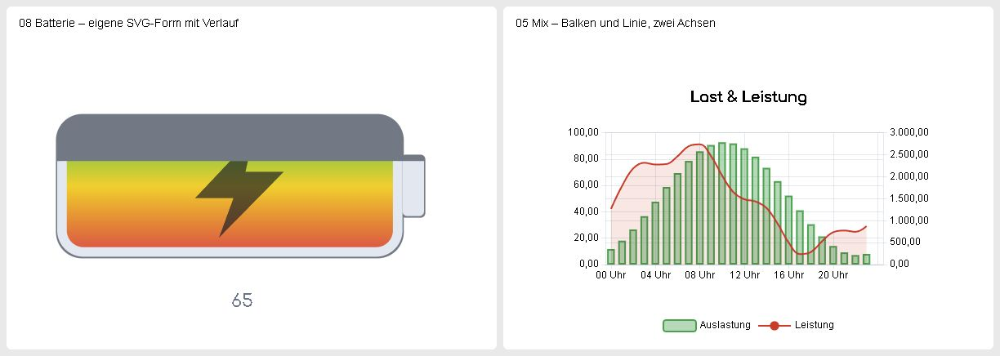

# EChartsTimeSeries

Gerätemodul für historische numerische Symcon-Werte als responsive Apache-
ECharts-Zeitreihe. Eine Instanz verarbeitet eine bis 32 eindeutige Quellen,
bis zu acht Wertachsen und rendert eine native Symcon-Kachel sowie
optional ein eigenständiges IPSView-WebContent-Widget.

Installation: Im **Symcon-Modulstore** nach **eCharts** suchen.
[Voraussetzungen und Einrichtung](../README.md#installation-und-erstes-diagramm)
(IP-Symcon 9.0/9.1, PHP 8.5, gemeinsames Gateway).
Alle technischen Felder, Standardwerte und Quellenparameter stehen in der
[Konfigurationsreferenz](../docs/KONFIGURATION.md#echartstimeseries).

## Beschriftungsoptionen

Punktwerte können bei Bedarf eingeblendet werden. Position, Abstand, Schriftgröße und Farbe sind unabhängig vom Achsen- und Legendentext einstellbar. Standardmäßig bleiben Punktwerte ausgeblendet; bei dichten Reihen können viele Labels überlappen.

Die Optionen gelten für Kacheln und – bei unabhängigem Design – auch für
IPSView. Bei geerbtem Design folgt IPSView den Kacheleinstellungen.

Linien und Datenpunkte, Flächen und Achsen sowie Schrift und Farben sind in
beiden Designern als eigene einklappbare Bereiche angeordnet; die Vorschau
folgt darunter.
Die schematische Vorschau zeigt bis zu vier anfänglich sichtbare Reihen und deren effektive
Einheitenachsen auf der konfigurierten Seite. Die Achsen übernehmen automatisch
die Farbe der ersten zugeordneten Reihe oder die ausdrücklich gewählte
Achsenfarbe. Bei festen Achsenbereichen zeigt die Vorschau Minimum und Maximum.
Kachel und IPSView zeigen die Archivwerte mit der vollständigen Skala.
Bei mehr als vier Quellen nennt die Vorschau die angezeigte und gesamte Anzahl;
Kachel und Widget nutzen weiterhin alle konfigurierten Reihen. Große SVG-Muster
werden nur in der Vorschau mit sichtbarem Hinweis durch einfache Farbflächen
ersetzt; das Live-Diagramm verwendet das vollständige Original.

## Vorübergehende Ladefehler

Kann das Archiv kurzzeitig nicht gelesen werden, bleibt die letzte gültige
Grafik in Kachel und IPSView sichtbar. Bei wiederholtem Fehler erscheint ein
Hinweis; das Modul versucht nach 60 Sekunden erneut zu laden. Ohne zuvor
geladene Daten oder bei ungültiger Konfiguration erscheint weiterhin eine
Fehlermeldung.

Bei einem Konfigurationsfehler zeigen Kachel und IPSView den Grund an.
Temperatur (°C) und Luftfeuchtigkeit (%) lassen sich gemeinsam anzeigen,
wenn beide Quellen die **Stapelgruppe 0** verwenden. Eine gemeinsame
Stapelgruppe benötigt dieselbe Einheit. Nach dem Korrigieren der Quellen
die Änderungen übernehmen, damit das Diagramm wieder angezeigt wird.

## Animation

Für Start und Aktualisierung lassen sich außerdem die **Bewegungskurve** und
eine feste **Verzögerung** (0–3000 ms) getrennt wählen. Ohne Änderung gilt
jeweils cubicInOut ohne Verzögerung. Die Verzögerung betrifft das ganze Diagramm,
nicht jeden Datenpunkt einzeln.

Im Kachel- und unabhängigen IPSView-Designer steuern **Animation**, **Startanimation** und **Aktualisierungsanimation** die ECharts-Übergänge. Beide Zeiten sind von 0 bis 3000 ms einstellbar; 0 ms unterdrückt den jeweiligen Übergang. Die Systemeinstellung für reduzierte Bewegung schaltet Animationen immer ab. Bei **Kacheldesign verwenden** übernimmt IPSView die Kachelwerte. Bei Zeitreihen ist Animation wegen der Datenmenge standardmäßig ausgeschaltet.

## Voraussetzungen

- IP-Symcon 9.0 oder 9.1 mit PHP 8.5;
- eine aktive [EChartsGateway-Instanz](../EChartsGateway/README.md);
- eine bis 32 Integer- oder Float-Variablen;
- eine Symcon-Archivinstanz für historische Modi; der Echtzeitmodus benötigt
  kein aktiviertes Logging;
- IPSView nur für das optionale WebContent-Widget.

Jede Reihe bleibt über ihre Variablen-ID eindeutig, auch wenn mehrere
Variablen denselben Namen oder dieselbe eigene Beschriftung haben. Solche
gleichlautenden Reihen behalten in Legende, Tooltip und Vorschau ihre Namen
ohne ID-Zusatz; Live-Updates bleiben der richtigen ID zugeordnet.
Objektpfade werden dafür nicht ausgewertet.

## PV-Leistung als gestapelte Flächen anzeigen

1. Unter **Zeitreihenquellen** die archivierten Leistungsvariablen der Dachflächen hinzufügen, zum Beispiel Ostdach und Westdach. Beide müssen dieselbe Einheit verwenden, etwa kW.
2. Für beide Quellen die **Stapelgruppe** auf **1** setzen und **Durchschnitt** wählen. Die Gruppennummer macht jede zugehörige Reihe zu einer Fläche. Mit Gruppe **0** lassen sich weiterhin einzelne Linien oder Flächen darüberlegen.
3. Im **Datenmodus** eine gemeinsame Verdichtung auswählen, zum Beispiel **15 Minuten**, und die Änderungen übernehmen.

Liefert das Ostdach in einer Viertelstunde durchschnittlich 2 kW und das Westdach 3 kW, erreicht die Oberkante 5 kW. Der Tooltip zeigt beide Einzelwerte und die sichtbare Summe der Gruppe. Blendest du das Westdach in der Legende aus, zeigt der Stapel für diese Viertelstunde 2 kW. Verwende für die Gesamtleistung den Mittelwert jeder Fläche im selben Intervall. Einzelne Spitzenleistungen können zu unterschiedlichen Zeiten auftreten.

Fehlt ein Archivwert einer Gruppenquelle, bleibt der gesamte Stapel an dieser Stelle unterbrochen. Das gilt auch für ausgeblendete Gruppenmitglieder und bei ausgeschalteter allgemeiner Lückenerkennung. Ein gemessener Wert von 0 kW zählt als vorhandener Beitrag. Andere Gruppen und Einzelreihen laufen unabhängig weiter.

Positive Beiträge wachsen oberhalb, negative unterhalb der Nulllinie. Bei gemischten Vorzeichen zeigt die sichtbare Summe im Tooltip die Bilanz, etwa 3 kW bei Beiträgen von 5 kW und −2 kW.

Die Gruppen **1–32** stehen bei automatischer und fester Verdichtung zur Verfügung. Für Rohwerte und Echtzeit mit unabhängigen Messzeitpunkten bleibt die Stapelgruppe auf **0**.

## Aktueller Funktionsumfang

- rollende Zeiträume von 1 Stunde, 6 Stunden, 24 Stunden, 7 Tagen und 30 Tagen
  sowie frei definierbare Fenster in Minuten, Stunden, Tagen oder Wochen;
- kalendergebundene Ansichten für heute, gestern, die laufende Woche den
  laufenden Monat und das laufende Jahr; die Grenzen folgen der Symcon-Zeitzone und berücksichtigen
  Zeitumstellungen;
- automatische Zeitachsenbeschriftung oder ausdrückliche Anzeige von Uhrzeit,
  Datum beziehungsweise Datum und Uhrzeit;
- ausdrücklich wählbare Rohwerte, automatische Verdichtung oder feste
  Verdichtung auf Minute, 5 Minuten, 15 Minuten, Stunde oder Tag;
- Echtzeitdarstellung nicht archivierter Variablen ab dem Öffnen der Kachel;
- wahlweise durchgehende Linien, automatische Erkennung zeitlicher Datenlücken
  je Reihe oder eine feste maximale Unterbrechungsdauer in Minuten;
- Linien- oder Flächendarstellung je Quelle;
- optionales Einzeldesign je Quelle für Linienart, Linienstärke, Glättung,
  Punktsymbol und Punktgröße sowie Flächendeckkraft;
- einfarbige Flächen, lineare Farbverläufe oder sicher importierte,
  größenverstellbare SVG-Flächenmuster;
- automatische Übernahme von Einheit und Nachkommastellen aus der
  Variablendarstellung mit manuellen Rückfallwerten;
- standardmäßig eine gemeinsame Y-Achse je effektiver Einheit, bei Bedarf eine
  eigene Wertachse pro Reihe mit eigenem Bereich und eigener Achsenseite;
- automatische Wertachsenbereiche sowie wahlweise die Übernahme von Minimum
  und Maximum aus der Variablendarstellung oder eine manuelle Vorgabe;
- automatische Wertachsen folgen den dargestellten Daten mit etwas Randabstand
  und schließen bei sichtbaren Stapeln den Nullpunkt ein. Auch beim Zeitzoom werden sie neu skaliert.
  Manuell oder aus der Variablendarstellung festgelegte Grenzen bleiben fest;
- quellenbezogene Referenzlinien und Wertebereiche mit Beschriftung,
  Reihenfarbe oder eigener Farbe sowie konfigurierbarer Linienart,
  Linienstärke und Bereichsdeckkraft;
- farblich gekoppelte Wertachsen: Achsenlinie, Teilstriche, Skalenwerte und
  Einheit übernehmen standardmäßig die Farbe der ersten zugeordneten
  Datenreihe;
- separat einstellbare Titel-, Legenden-, Achsen- und Rasterfarben sowie
  Titel-, Legenden- und Achsenschriftgrößen (50 bis 200 Prozent) im Kachel-
  und unabhängigen IPSView-Designer. **Automatisch** behält Theme-Farben und
  die farbliche Kopplung der Wertachsen an ihre Datenreihe bei; eine explizite
  Achsenfarbe gilt für alle Zeit- und Wertachsen;
- waagerechte Gitterlinien an den Werten und optionale **senkrechte Gitterlinien**
  an der Zeitachse. Beide Richtungen lassen sich unabhängig einblenden und
  einfärben. Für ein abweichendes Raster in IPSView deaktivieren Sie
  **Kacheldesign verwenden** im IPSView-Designer;
- gemeinsames Punktbudget von 200 bis 32.000 Punkten (Standard weiterhin
  2.000), maximal 2.000 je Reihe;
- scrollbare Legende mit einzelner Reihenauswahl sowie **Alle** und
  **Umkehren**; je Quelle ist **Anfangs sichtbar** einstellbar;
- Durchschnitt, Zählersumme, Minimum und Maximum entsprechend dem
  versionierten Archivvertrag;
- native Kachel mit lokalen, integritätsgeprüften ECharts- und Theme-Dateien;
- Mausrad-Zoom und eine höhenverstellbare Zoomleiste in der nativen Kachel und im
  IPSView-WebContent-Widget;
- der gewählte Zoom-Ausschnitt bleibt bei normalen Datenaktualisierungen erhalten;
- kollabierter Kacheldesigner mit sofortiger SVG-Vorschau für Theme,
  Legendenposition, Zoom, Linienstärke, Glättung, Datenpunkte,
  Flächendeckkraft, Raster, Achsensichtbarkeit, Schrift und Farben;
- optionales IPSView-WebContent-Widget mit demselben Datenmodell und wahlweise
  geerbtem oder vollständig unabhängigem Zeitreihendesign sowie einem
  wahlweise von der Kachel abweichenden Zeitraum und Zeitachsenformat;
- Rohwertfortschreibung über `VM_UPDATE`, ohne bei jedem Messwert das Archiv
  erneut zu laden;
- aggregierte Reihen enden am letzten abgeschlossenen Zeitfenster und werden
  nach der nächsten Intervallgrenze neu geladen.

Das Theme **Automatisch (Symcon-Design)** übernimmt in der nativen Kachel
Hintergrund, Text- und Oberflächenfarben aus dem aktiven hellen oder dunklen
Symcon-Design. Für eine feste Farbe neben dem Theme **Diagrammhintergrund**
wählen. Für ein deckend schwarzes Diagramm in beiden Ausgaben Schwarz
(`#000000`) wählen, **Kacheldesign verwenden** eingeschaltet lassen und
**An IPSView-Hintergrund anpassen** ausschalten. Senkrechte Linien lassen sich
mit **Senkrechte Gitterlinien anzeigen** und **Farbe der senkrechten Gitterlinien**
direkt auf diesem Hintergrund einstellen.

Archivmodi lesen das Symcon-Archiv ausschließlich über die gemeinsame
`EChartsGateway`-Operation `archive.read`. Der getrennte Echtzeitmodus beginnt
mit `current.read` und sammelt danach Variablenänderungen nur im geöffneten
Browser. Er benötigt kein Archiv, besitzt nach einem Neuladen aber bewusst
keine rückwirkende Historie. Das Modul aktiviert kein Logging und
verändert weder Archivkonfiguration noch Archivdaten. Eine leere gültige
Archivantwort bleibt eine leere Datenreihe. Bei gekürzten Rohwerten zeigt die
Kachel einen Hinweis auf das wirksame Punktbudget.

## Einrichtung

1. Eine bestehende gemeinsame `EChartsGateway`-Instanz als Parent auswählen.
2. Eine bis 32 Integer- oder Float-Variablen konfigurieren. Archivmodi
   benötigen archivierte Quellen; `realtime` funktioniert auch ohne Archiv.
3. Zeitraum, Beschriftung der Zeitachse, Datenmodus und Punktbudget wählen.
   Bei **Benutzerdefiniert** werden Zeitraumwert und -einheit verwendet.
   **Heute**, **Gestern**, **Diese Woche** und **Dieser Monat** verwenden lokale
   Kalendergrenzen statt eines rollenden Sekundenfensters. **Gestern** ist ein
   abgeschlossener Zeitraum und benötigt deshalb einen Archivdatenmodus. Die
   Zeitachse kann ECharts automatisch beschriften oder ausdrücklich Uhrzeit,
   Datum beziehungsweise beides anzeigen.
   Die Datenlückenerkennung ist standardmäßig deaktiviert. **Automatisch**
   unterbricht eine Linie, wenn ein Abstand größer als das Dreifache des
   typischen Messabstands dieser Reihe ist. Alternativ lässt sich ein fester
   Maximalabstand in Minuten für alle Reihen festlegen.
4. Optional Beschriftung, Einheit, Nachkommastellen, Farbe, Stil, Reducer,
   Achsenseite und Achsenbereich pro Quelle anpassen. Der Bereich bleibt
   standardmäßig automatisch, kann aber aus der Variablendarstellung oder aus
   manuell eingegebenem Minimum und Maximum stammen. Quellen mit derselben
   effektiven Einheit teilen standardmäßig eine Achse und verwenden deshalb dieselbe
   ausdrücklich gewählte Seite und denselben expliziten Bereich. Automatische
   Quellen übernehmen dabei den expliziten Bereich ihrer Einheitengruppe.
   Für Feuchtigkeit (0 bis 100 %) und Außentemperatur (−20 bis 40 °C) kannst
   Du bei beiden Quellen **Links** und einen **manuellen** Bereich wählen.
   Die unterschiedlichen Einheiten ergeben bereits zwei getrennte Achsen.
   Für eine weitere Temperatur öffnest Du das Zahnrad dieser Quelle und
   aktivierst unter **Wertachsenbereich** die **Eigene Wertachse**. Wähle
   als **Achsenseite** **Rechts** und als **Achsenbereich** **Manuell**.
   Mit Minimum 20 und Maximum 60 erhältst Du rechts die zweite °C-Skala.
   Gestapelte Reihen verwenden eine gemeinsame
   Wertachse. Insgesamt stehen bis zu acht Wertachsen zur Verfügung.
   Der Farbwähler verwendet **Automatisch** für die Farbfolge des
   gewählten Themes; eine ausgewählte Farbe überschreibt sie für diese Reihe.
   Über das Zahnrad einer Quelle kann außerdem das **Einzeldesign** aktiviert
   werden. Ohne Einzeldesign erbt die Reihe weiterhin alle gemeinsamen Werte
   des Kachel- beziehungsweise IPSView-Designers. SVG-Flächenmuster werden nur
   für den Flächenstil verwendet und vor der Ausgabe sicher validiert.
5. Optional den Kacheldesigner öffnen und Darstellung sowie Vorschau anpassen.
6. Für normale Messkurven genügt der Eintrag unter **Zeitreihenquellen**.
   **Referenzlinien und Wertebereiche (optional)** kann leer bleiben. Hier
   lassen sich bis zu 32 feste Markierungen ergänzen. Die **zugehörige Zeitreihe**
   bestimmt die Wertachse und Einheit. Für eine waagerechte Linie bei 25 °C
   die Temperaturreihe wählen und **Wert / Minimum** auf 25 setzen. Für ein
   farbiges Band von 40 bis 60 % die Feuchtereihe wählen und 40 sowie 60
   als Grenzen eintragen. Ohne eigene Farbe übernimmt die Markierung die
   Reihenfarbe. Beim Entfernen einer Quelle auch ihre Markierungen löschen
   oder einer passenden verbleibenden Reihe zuordnen.
7. Optional im Abschnitt **IPSView-Design** die WebContent-Ausgabe aktivieren.
   Standardmäßig übernimmt sie Kacheldesign und Zeiteinstellungen. Wird
   **Zeiteinstellungen der Kachel verwenden** deaktiviert, erhält IPSView
   einen eigenen Zeitraum und ein eigenes Format der Zeitachsenbeschriftung.
   Diese Zeiteinstellungen stehen bei den allgemeinen Zeitraumoptionen,
   außerhalb der beiden Designer. Für eine abweichende Gestaltung zuerst
   **Kacheldesign verwenden** ausschalten. Solange es aktiv ist, sind die
   eigenen Designfelder und der Knopf **Kacheldesign nach IPSView kopieren und
   unabhängig bearbeiten** direkt im Abschnitt **IPSView-Design** deaktiviert.
   Nach dem Ausschalten kopiert der Knopf die aktuellen Kachelfelder in den IPSView-Designer.
   Die Vorschau zeigt auch ungespeicherte Änderungen sofort. Mit **Übernehmen** speicherst Du das Design.
   **An IPSView-Hintergrund anpassen** lässt den tatsächlichen
   IPSView-Hintergrund durchscheinen. Die **Hintergrundfarbe**
   verwendet automatisch die Theme-Farbe oder eine frei gewählte Tönung; die
   **Hintergrunddeckkraft** dosiert den darüberliegenden Theme-Hintergrund von
   0 bis 100 Prozent. Die erzeugte Variable **Zeitreihe für
   IPSView** wird als HTML-Widget in IPSView platziert.

Beim Abschalten bleibt eine bereits angelegte WebContent-Variable erhalten,
wird aber nicht weiter aktualisiert. Sie kann im selben Formular ausdrücklich
gelöscht oder bei aktivierter Ausgabe neu erzeugt werden. Für eigene Skripte
liefert `ECTS_GetIPSViewHTML($InstanceID)` das vollständige eigenständige
HTML-Dokument.

Bis zu acht unterschiedliche effektive Einheiten sind möglich. Automatisch
verteilt die Einheitenachsen auf beide Seiten; mehrere Achsen derselben Seite
werden versetzt dargestellt. Unter **Kacheldesigner → Flächen und Achsen →
Abstand der Wertachsen** bestimmt `0` den Abstand automatisch. Mit **24 px**
kannst Du zum Beispiel die zweite linke Skala näher an die erste rücken.
Du kannst 1 bis 120 px vorgeben. Reicht der Platz bei vielen Achsen oder in
einer schmalen Kachel nicht aus, verkleinert das Diagramm den Abstand.
Für einen anderen Abstand in IPSView deaktiviere **Kacheldesign verwenden**
und stelle den Wert im **unabhängigen IPSView-Designer** ein. Beide
Vorschauen zeigen den Abstand zwischen den sichtbaren Wertachsen.

Für eine größere Zeitleiste auf dem Handy öffne den **Kacheldesigner**.
Neben **Zoom aktivieren** stellst Du die **Reglerdicke (0 = automatisch)** ein.
Probiere beispielsweise **32 px** aus. Möglich sind 1 bis 64 px. Bei **0** wählt
das Diagramm die bisherige Höhe automatisch. Bei sehr wenig Platz begrenzt es
die Höhe, damit die Kurven sichtbar bleiben. Für einen eigenen Wert in IPSView
deaktiviere **Kacheldesign verwenden** und stelle die Reglerdicke im
**IPSView-Designer** ein. Die Vorschau zeigt die gewählte Höhe.

`raw` bleibt immer eine echte Rohwertabfrage; `realtime` ist der ausdrücklich
archivfreie Live-Modus und nur `auto` wählt selbstständig eine
Verdichtungsstufe.

### Zeitraum direkt im Diagramm wechseln

Aktiviere im Kacheldesigner **Zeitraumauswahl anzeigen**. Unter dem Diagramm erscheint die aktuelle Auswahl. Ein Tipp öffnet die Zeiträume, etwa **6 Stunden**, **24 Stunden**, **Heute**, **Diese Woche**, **Dieser Monat** oder **Dieses Jahr**. Bei **24 Stunden** reicht das Fenster vom aktuellen Zeitpunkt aus zurück. **Heute** beginnt um Mitternacht in der Symcon-Zeitzone.

Beim Wechsel lädt das Diagramm die Archivwerte für den gewählten Zeitraum mit der eingestellten Verdichtung und dem vorhandenen Punktbudget. Die Zoomleiste dient weiterhin zum Vergrößern eines Ausschnitts. Die Auswahl gilt nur für die geöffnete Ansicht. Beim erneuten Öffnen gilt wieder der konfigurierte Zeitraum. Für IPSView kannst Du **Kacheldesign verwenden** deaktivieren und die Auswahl getrennt einblenden.

Im Datenmodus **Echtzeit** sammelt das Diagramm nur neue Werte ab dem Öffnen. Die Archiv-Zeitraumauswahl erscheint deshalb ausschließlich in den Archivmodi.

## Viele Reihen und Reihenauswahl

**Anfangs sichtbar** ist ohne abweichende Einstellung aktiviert. Die Legende
blättert bei Platzmangel; ein Klick schaltet die betreffende Reihe um.
**Alle** blendet alle Reihen ein, **Umkehren** kehrt die Auswahl um. Nach
**Alle** und **Umkehren** sind alle ausgeblendet. Auswahl, Legendenposition
und Zeitzoom bleiben bei Datenaktualisierung, Umsortierung und Größenänderung
anhand der Variablen-IDs erhalten. Ein Neuladen verwendet wieder die
konfigurierten Anfangswerte. Die Auswahl wird nicht in der Instanz gespeichert.
Achsen und Referenzmarkierungen ausgeblendeter Reihen werden ebenfalls
ausgeblendet; gemeinsam verwendete Achsen bleiben für sichtbare Reihen erhalten.

Das Gesamtpunktbudget wird gleichmäßig auf **alle konfigurierten Reihen**
verteilt und je Reihe auf höchstens 2.000 begrenzt. Ausgeblendete Reihen werden
weiter gelesen und aktualisiert; ihre Punkte werden nicht auf andere Reihen
umverteilt. Bei 32 Reihen und Standardbudget 2.000 stehen höchstens 62 Punkte
je Reihe bereit, bei Budget 32.000 höchstens 1.000. Ein höheres Budget erhöht
Ladezeit und Ressourcenbedarf; es garantiert keine bestimmte Archivdichte.

Zusätzlich gelten 900.000 Bytes für das serialisierte Modell und 1 MiB für
das vollständige HTML-Dokument. Lange Texte, komplexe SVG-Muster und hohe
Zahlenpräzision können diese Grenze vor dem Punktbudget erreichen. In diesem
Fall fordert eine Fehlermeldung ein kleineres Punktbudget oder einfachere
Muster an; Werte werden nicht stillschweigend gerundet oder entfernt. Große
Startzustände werden verlustfrei komprimiert. Dafür benötigt der Browser
Unterstützung für die native gzip-Dekomprimierung (`DecompressionStream`).

## Variablen

Standardmäßig legt das Modul keine Statusvariablen an. Bei aktivierter
IPSView-Ausgabe wird die Stringvariable **Zeitreihe für IPSView** mit dem Ident
`IPSViewTimeSeries` und einer WebContent-Darstellung erzeugt. Beim Abschalten
bleibt eine bereits angelegte Variable erhalten, bis sie im Formular
ausdrücklich gelöscht wird.

## Übernommene JSLive-Modelle



Die Aufnahme zeigt native Kachelausgaben aus der Testinstallation. Rechts
ist eine importierte TimeSeries-Mischdarstellung zu sehen; links eine
separate EChartsProgress-Instanz. Beide bleiben eigenständige Diagramme.

Das [EChartsGateway](../EChartsGateway/README.md) kann geprüfte JSLive-Pakete
nach ausdrücklicher Bestätigung als **neue** Instanzen übernehmen. Bestehende
Diagramme und Quellen bleiben erhalten. Die importierte Variante erhält ein
eigenes, aus dem Export gebildetes Modell; die reguläre Einrichtung dieses
Moduls bleibt unverändert. Quellen- und Archiv-IDs sowie native Formatierungen
werden erhalten, ohne Legacy-Profile anzulegen. Der Importbericht nennt
Darstellungs- und Verarbeitungsunterschiede einzeln.

Importierte Modelle bieten Titel, Zeitsteuerung bei historischen Modellen,
Hintergrund-/Schriftanpassungen und Sichtbarkeitseinstellungen für Kachel und
IPSView. Die Farbkarte ist schematisch; **Native Vorschau herunterladen** zeigt
die tatsächliche ECharts-Ausgabe mit noch nicht gespeicherten Entwurfswerten.
Quellen und vollständige ursprüngliche Stile stammen aus dem Importmodell;
sie werden nicht in die reguläre Quellen-/Designerstruktur zurückübersetzt.
Bei einer neuen Übernahme eines geänderten Exports ist ausdrücklich eine
separate Neuanlage erforderlich. Das bisherige Ziel wird nicht überschrieben.

## Konfigurationsreferenz und Skriptzugriff

Die [Feldreferenz](../docs/KONFIGURATION.md#echartstimeseries) enthält
Formularbeschriftungen, technische Namen, Typen, Standardwerte und Auswahllisten.
Für Skriptänderungen gelten die dort erläuterten JSON- und Anwenderegeln.

### Ausgabevariable

| Ident | Typ / Darstellung | Bedeutung | Einheit | Bedienbar |
| --- | --- | --- | --- | --- |
| `IPSViewTimeSeries` | String / WebContent | HTML-Dokument für das optionale IPSView-Widget | keine | Nein |

Die Variable entsteht bei aktivierter IPSView-Ausgabe. Nach deren Abschalten
bleibt sie erhalten, wird aber nicht weiter aktualisiert. Die ausdrückliche
Löschaktion im Formular entfernt sie samt ihrer bisherigen Verknüpfbarkeit.
Quellvariablen und deren Archive bleiben unverändert. Weitere Statusvariablen
werden für das reguläre Diagramm nicht angelegt.

### Öffentliche PHP-Funktionen

`$InstanzID` bezeichnet immer diese Modulinstanz, nicht eine Quellvariable
oder das Gateway. Alle aufgeführten Argumente beim Symcon-Aufruf übergeben.

| Signatur | Rückgabe und Wirkung |
| --- | --- |
| `ECTS_CopyTileDesignToIPSView(int $InstanzID): void` | Überträgt die gespeicherten Kachelwerte in den geöffneten IPSView-Formularentwurf. Erst **Übernehmen** speichert die Kopie. |
| `ECTS_GetTimeSeriesData(int $InstanzID): string` | Liest das reguläre konfigurierte Diagrammmodell als JSON; keine Änderung von Quellen oder Archivwerten. |
| `ECTS_GetTimeSeriesDiagnostic(int $InstanzID): string` | JSON-Momentaufnahme der Konfigurationsprüfung und letzten Fehlermeldung; kein Nachweis einer erfolgreichen Datenabfrage. |
| `ECTS_GetIPSViewHTML(int $InstanzID): string` | Vollständiges HTML-Dokument für IPSView; der Rückgabewert bestätigt keine Anzeige in einem Client. |
| `ECTS_RefreshArchive(int $InstanzID): void` | Aktualisiert die Diagrammausgaben aus den konfigurierten Quellen. Kein Erfolgswert und keine Änderung von Quellen/Archiven. |
| `ECTS_GetJSLiveImportHTML(int $InstanzID, bool $IPSView): string` | `$IPSView=false`: Kachelausgabe; `true`: IPSView-Ausgabe eines übernommenen JSLive-Modells als vollständiges HTML. |
| `ECTS_RefreshJSLiveImport(int $InstanzID): void` | Aktualisiert die Diagrammausgaben aus den konfigurierten Quellen. Kein Erfolgswert und keine Änderung von Quellen/Archiven. Nur für importierte Modelle. |
| `ECTS_GetJSLiveImportData(int $InstanzID): string` | JSON-Zustand eines übernommenen JSLive-Modells einschließlich Verfügbarkeit; nur für importierte Varianten. |

Beispiel mit synthetischer Instanz-ID (durch die eigene ID ersetzen):

```php
$instanceID = 12000;
$model = json_decode(ECTS_GetTimeSeriesData($instanceID), true, 512, JSON_THROW_ON_ERROR);
```

Die fachlichen Grenzen dieser Anleitung gelten auch bei Skriptaufrufen.
Ungültige Konfigurationen, fehlende Quellen oder ein nicht verfügbares Gateway
können eine Ausnahme beziehungsweise einen ausdrücklich nicht verfügbaren
Zustand liefern. Solche Rückgaben nicht als leeren oder mit null aufgefüllten
Messbestand auswerten. Archivabfragen können den kurzzeitigen Gateway-Cache
nutzen; ein Aufruf garantiert keinen neu protokollierten Messwert.

## Lizenz

Die eigenen Beiträge stehen unter der
[PolyForm Noncommercial License 1.0.0](../LICENSE).
Für Fremdkomponenten gelten deren [Originallizenzen](../THIRD_PARTY_NOTICES.md).
