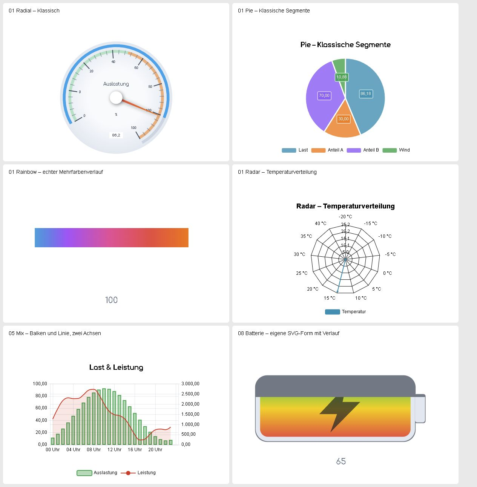

# SymconECharts

[](https://www.symcon.de)
[](library.json)
[](LICENSE)
[](https://github.com/Burki24/SymconECharts/actions/workflows/style.yml?query=branch%3Adev)
[](https://github.com/Burki24/SymconECharts/actions/workflows/tests.yml?query=branch%3Adev)

SymconECharts stellt aktuelle und archivierte Symcon-Werte sowie ausgewählte
Objektbeziehungen als responsive Apache-ECharts-Diagramme dar. Die Library
enthält **31 Diagrammmodule und ein gemeinsames Gateway**. Native Symcon-Kacheln
und optionale IPSView-WebContent-Widgets verwenden dieselben Quellen; ihr
Design kann gemeinsam oder unabhängig eingestellt werden.

## Voraussetzungen

- IP-Symcon 9.0 oder 9.1 mit PHP 8.5.
- Für wertbasierte Diagramme passende numerische Variablen; StateTimeline und
  die Zustandsdauer von CalendarPie verwenden Boolean-/Integer-Zustände.
  Tree und Graph können auch andere Symcon-Objekte darstellen.
- Für historische Diagramme ein vorhandenes Symcon-Archiv mit bereits
  protokollierten Werten. Eine spätere Aktivierung erzeugt keine älteren Daten.
  Der Echtzeitmodus von TimeSeries benötigt kein Archiv.
- IPSView nur für die optionale IPSView-Ausgabe.

## Installation und erstes Diagramm

1. Die Library in der Symcon-Modulverwaltung über diese Repository-URL hinzufügen:

   ```text
   https://github.com/Burki24/SymconECharts
   ```

2. Eine Instanz der gewünschten Diagrammfamilie anlegen. Beim ersten Diagramm
   ein `EChartsGateway` als Parent erstellen; weitere Diagramme mit diesem
   vorhandenen Gateway verbinden. Zusätzliche Gateways sind zulässig, im
   Normalbetrieb genügt eines für alle Familien.
3. Quellen und fachliche Datenregeln im Instanzformular festlegen. Titel,
   Zeitbereich und Design einstellen und die Änderungen übernehmen.
4. Die Diagramminstanz in einer nativen Symcon-Kachel anzeigen. Die Vorschau
   hilft bei der Gestaltung; sie ersetzt die tatsächliche Kachel nicht.
5. Bei Bedarf **IPSView-HTML-Ausgabe bereitstellen** einschalten, übernehmen
   und die erzeugte Stringvariable mit WebContent-Darstellung in IPSView einbinden.

Die ECharts-Runtime **6.1.0** und die angebotenen Themes werden lokal mitgeliefert.
Im Betrieb wird keine aktuelle Version von einem CDN nachgeladen.

## Beispiele aus der Testinstallation



Diese Aufnahmen zeigen bereits übernommene JSLive-Testdiagramme mit
synthetischen Bezeichnungen in der MCP-Kachelvorschau der Testinstallation.
Es sind native HTML-Kachelausgaben; die bewegte Verlaufspalette ist als einzelne
Phase abgebildet.
Weitere Erläuterungen stehen in der [Migrationsanleitung](docs/JSLIVE_MIGRATION.md).

## Enthaltene Module

Die folgenden Grenzen gelten jeweils zusammen mit den zusätzlichen Daten-,
Archiv- und Ausgabegrenzen der verlinkten Modulanleitung.

| Modul | Verwendung |
| --- | --- |
| [EChartsGateway](EChartsGateway/README.md) | Gemeinsame Datenanbindung und bestätigte JSLive-Übernahme; keine eigene Diagrammkachel. |
| [EChartsGaugeSingle](EChartsGaugeSingle/README.md) | Ein aktueller Zahlenwert als individuell gestaltbares Instrument. |
| [EChartsGaugeMulti](EChartsGaugeMulti/README.md) | 2–32 aktuelle Werte mit eigenen Skalen, Quellenauswahl und Seiten. |
| [EChartsGaugeTacho](EChartsGaugeTacho/README.md) | 2–5 aktuelle Werte als Tacho-Cockpit mit Haupt- und Nebeninstrumenten. |
| [EChartsGaugeChronograph](EChartsGaugeChronograph/README.md) | 2–5 aktuelle Werte als Chronograph mit Hilfszifferblättern. |
| [EChartsTimeSeries](EChartsTimeSeries/README.md) | 1–32 historische oder live fortgeschriebene Linien-/Flächenreihen; bis zu 32000 Gesamtpunkte. |
| [EChartsBarCategory](EChartsBarCategory/README.md) | 1–100 aktuelle Quellen als einfache, gruppierte oder gestapelte Balken mit Kategoriennavigation. |
| [EChartsBarHistory](EChartsBarHistory/README.md) | 1–32 Archivquellen als Zeitbalken mit Reihenauswahl; bis zu 32000 Gesamtpunkte. |
| [EChartsBarWaterfall](EChartsBarWaterfall/README.md) | 2–100 aktuelle Quellen als Bilanz mit optionalen Zwischensummen und Neustarts. |
| [EChartsBarPolar](EChartsBarPolar/README.md) | 1–100 aktuelle Quellen als Polarbalken mit optionaler Auswahl und Seiten. |
| [EChartsPie](EChartsPie/README.md) | 1–100 aktuelle Quellen als Kreis, Donut oder Rose mit optionaler Auswahl. |
| [EChartsScatter](EChartsScatter/README.md) | Historische X/Y-Punktwolken und Bubble-Diagramme; bis zu 16 benannte Vergleichsgruppen. |
| [EChartsHeatmap](EChartsHeatmap/README.md) | Archiv-Stundenkennzahlen nach Tagen oder Wochentagen, mit Zeitnavigation und bis zu vier Vergleichsansichten. |
| [EChartsTree](EChartsTree/README.md) | Lesender Symcon-Objektbaum mit bis zu zwölf Nachkommensebenen. |
| [EChartsTreeSystemHealth](EChartsTreeSystemHealth/README.md) | Objektbaum mit ausdrücklich festgelegten Zustandsregeln; bis zu zwölf Nachkommensebenen. |
| [EChartsGraph](EChartsGraph/README.md) | Bis zu 300 manuelle Objektknoten und 1000 Verbindungen, optional gerichtet und gewichtet. |
| [EChartsGraphZ2M](EChartsGraphZ2M/README.md) | Lesende Darstellung einer vorhandenen Zigbee2MQTT-Netzwerkkarte; kein Netzwerkscan. |
| [EChartsTreemap](EChartsTreemap/README.md) | Bis zu 100 aktuelle Quellen als Rechteckhierarchie mit höchstens acht Ebenen einschließlich Blatt. |
| [EChartsSunburst](EChartsSunburst/README.md) | Dieselbe manuelle Hierarchie als konzentrische Ringe mit höchstens acht Ebenen. |
| [EChartsParallel](EChartsParallel/README.md) | 2–16 Archivachsen mit verschiebbarer Ansicht, eigenen Skalen und Kennzahlen; bis zu 10000 Aggregate. |
| [EChartsSankey](EChartsSankey/README.md) | Aktuelle Flüsse zwischen bis zu 100 Knoten mit bis zu 200 Verbindungen, optionaler Umkehr und Bilanzknoten. |
| [EChartsCalendar](EChartsCalendar/README.md) | Archiv-Tageskennzahlen als Jahr, Quartal, Monat oder fester Zeitraum mit Navigation. |
| [EChartsRadar](EChartsRadar/README.md) | Bis zu 16 aktuelle Vergleichsgruppen auf 3–10 Achsen, optional invers oder unvollständig. |
| [EChartsBoxplot](EChartsBoxplot/README.md) | Verteilung von Archiv-Stundenmitteln aus bis zu 32 Quellen; Min/Max- oder IQR-Whisker mit Ausreißern. |
| [EChartsFunnel](EChartsFunnel/README.md) | 1–32 aktuelle nichtnegative Stufenwerte mit optionaler Auswahl und Stufennavigation. |
| [EChartsCandlestick](EChartsCandlestick/README.md) | Archiv-OHLC in 15-/30-Minuten-, Stunden-, Tages- oder Wochenintervallen; bis zu vier Panels und gemeinsamer Zoom. |
| [EChartsPictorialBar](EChartsPictorialBar/README.md) | 1–100 aktuelle Quellen als Symbolbalken mit Symcon-Icons, eigenen SVG-Formen und Farbverläufen. |
| [EChartsThemeRiver](EChartsThemeRiver/README.md) | Bis zu 16 Archivbänder aus Stunden-/Tagesmitteln oder Zählerverbrauch; optional mit Bandauswahl. |
| [EChartsStateTimeline](EChartsStateTimeline/README.md) | Archivierte Boolean-/Integer-Zustände aus bis zu 32 Quellen als Zeitabschnitte mit Zeilennavigation. |
| [EChartsCalendarPie](EChartsCalendarPie/README.md) | Monatskalender mit Tageskreisen: 1–5 numerische Quellen oder Zeitanteile archivierter Zustände. |
| [EChartsRadarHistory](EChartsRadarHistory/README.md) | Übernommene historische JSLive-Radarmodelle mit Klassen- und Referenzregeln. |
| [EChartsProgress](EChartsProgress/README.md) | Übernommene JSLive-Pfad- und SVG-Fortschrittsmodelle mit eigenen Wertebereichen und Verläufen. |

## Konfiguration und Bedienung

Die Modul-READMEs beschreiben Einrichtung, fachliche Regeln, sichtbare Variablen
und Skriptzugriff. Die [Konfigurationsreferenz](docs/KONFIGURATION.md) ergänzt
Formularbeschriftungen, technische Property-Namen, Datentypen, Standardwerte,
Auswahlwerte und Quellenfelder für alle Module.

Eine Datenquelle wird über ihre Symcon-Variablen-ID zugeordnet. Namen, Pfade
und eigene Beschriftungen dienen der Anzeige oder Gruppierung. Eine eigene
Beschriftung hat Vorrang vor dem aktuellen Variablennamen; gleiche sichtbare
Namen bleiben technisch getrennte Quellen. Die Diagramme ändern keine
Quellwerte, Darstellungen oder vorhandenen Archivdaten.

### Kachel und IPSView gestalten

Die Designer ordnen Einstellungen in einklappbaren Themenbereichen an. Ein
konfigurierter Diagrammtitel steht in der Kachel unter dem Symcon-Kachelnamen
und dem Vergrößerungsbutton. IPSView zeigt keinen zusätzlichen Kachelkopf.
Die Theme-Auswahl und die geometrische Vorlage sind getrennte Einstellungen.

**Kacheldesign verwenden** ist für IPSView standardmäßig aktiv. Für ein eigenes
IPSView-Design diesen Schalter ausschalten. In den regulären Designern übernimmt
der Knopf **Kacheldesign nach IPSView kopieren und unabhängig bearbeiten** das zuletzt gespeicherte
Kacheldesign einmalig und überschreibt dabei bisherige unabhängige Designwerte.
Änderungen am Kacheldesign deshalb vor dem Kopieren speichern. Quellen bleiben
gemeinsam; gesonderte IPSView-Zeiträume und Hintergründe werden unabhängig von
der Designvererbung gesteuert, soweit das Modul sie anbietet.

Animationen berücksichtigen die Systemeinstellung für reduzierte Bewegung.
Reguläre Designer bieten getrennte Zeiten, Bewegungskurven und Verzögerungen
für Start und Aktualisierung; importierte JSLive-Modelle besitzen die in ihrer
Modulanleitung beschriebenen eigenen Designfelder.

Bei deaktivierter IPSView-Ausgabe bleibt eine bereits erzeugte HTML-Variable
erhalten und wird nicht mehr aktualisiert. Erst die ausdrückliche Löschaktion
im Formular entfernt sie; vorhandene IPSView-Verknüpfungen würden dann ungültig.

### Vorschau und Navigation

Reguläre Diagrammformulare zeigen eine unmittelbar aktualisierte SVG-Vorschau,
auch für noch nicht gespeicherte Titel-, Quellen- und Designänderungen.
Historische Vorschauen verwenden gekennzeichnete Beispieldaten und lösen keine
Archivabfrage aus. Je Familie kann die Vorschau nur einen Ausschnitt zeigen.
Maßgeblich für responsive Geometrie, echte Werte und Navigation ist die Kachel
beziehungsweise das IPSView-Widget. Importierte JSLive-Modelle bieten zusätzlich
herunterladbare native HTML-Vorschauen.

Quellenwahl, Seiten, Zoom und Verschiebung ändern die Ansicht. Verdeckte Quellen
bleiben in den fachlichen Prüfungen und Ladebudgets enthalten. Welche Skalen
und Summen vollständig erhalten bleiben, erklärt die jeweilige Modulanleitung.
Mausradaktionen gelten für den Bereich unter dem Mauszeiger; Listen scrollen
innerhalb ihres Bereichs, Diagrammzoom bleibt familienabhängig. Ctrl-/Meta-
Mausrad bleibt der umgebenden Anwendung vorbehalten. Webclient und native
IPSView-App sind unterschiedliche Clients.

### Messwerte und Archivzeiträume

Pie, BarCategory, BarPolar, PictorialBar, Treemap und Sunburst erlauben eine
optionale Min/Max-Normalisierung je Quelle. Damit lassen sich unterschiedliche
Messgrößen relativ vergleichen. Originalwerte und Einheiten bleiben erhalten;
normalisierte Anteile oder Gruppensummen sind keine physikalischen Mengen.
Ohne diese Auswahl gelten die Rohwertregeln der jeweiligen Familie.

Boxplot, Parallel, Candlestick, ThemeRiver und StateTimeline bieten rollierende
Standardfenster, benutzerdefinierte Dauern und feste historische Von-/Bis-
Zeiträume. Calendar und Heatmap besitzen eigene Kalender- und Navigationsmodelle.
Es gelten die Symcon-Zeitzone und die jeweiligen Vollintervall-, Vorgänger-
und Budgetregeln. Fehlende Archivwerte werden nicht pauschal durch null ersetzt.
Ein größeres Zeitfenster erhöht kein Ladebudget automatisch.

## Migration von JSLive nach ECharts

Das [Gateway](EChartsGateway/README.md#4-einrichten-der-instanzen-in-symcon)
prüft JSLive-Exportpakete des Vertrags 1.0 zunächst lesend. Der anschließende
native Übernahmeplan nennt Quellenzuordnungen, Zielfamilien und einzeln zu
bestätigende Abweichungen. Erst die ausdrückliche Bestätigung legt neue
Instanzen an. Importjournal und kontrollierter Wiederanlauf erhalten das
JSLive-Original, Quellen, Archivwerte und bestehende Zielkonfigurationen.

Die [Migrationsanleitung](docs/JSLIVE_MIGRATION.md) beschreibt Export, Prüfung,
Bestätigung, Wiederholung und den Vergleich der Darstellungen Schritt für Schritt.
Profilinformationen werden in profilunabhängige native Formatierungen übersetzt;
die Quellvariablen werden dabei nicht umgestellt. Fremde Skripte und eigene
ausführbare Vorlagen werden nicht ausgeführt. Eine pixelgleiche oder beliebige
1:1-Migration wird nicht versprochen.

## Änderungen

Die Versionshistorie steht in der [CHANGELOG.md](CHANGELOG.md).

## Lizenz

Die eigenen Beiträge stehen unter der
[PolyForm Noncommercial License 1.0.0](LICENSE).
SPDX-Identifier: `PolyForm-Noncommercial-1.0.0`.

Required Notice: Copyright 2026 Burkhard Kneiseler. SymconECharts.

Fremdkomponenten behalten ihre Originallizenzen. Version, Herkunft, Integrität
und Lizenz stehen in [THIRD_PARTY_NOTICES.md](THIRD_PARTY_NOTICES.md).
SymconECharts ist kein offizielles Projekt der Apache Software Foundation.
