# Migration von JSLive nach SymconECharts

Die Übernahme erspart den manuellen Neuaufbau unterstützter JSLive-Diagramme.
Sie erhält Quellenbezüge, Zeit- und Berechnungsregeln sowie die übertragbaren
Designangaben in einem eigenen nativen Modell. JSLive und SymconECharts bleiben
getrennte Libraries. Das Original bleibt als Vergleich und Rückfall erhalten.

## Was erhalten bleibt

| Bereich | Verhalten bei der Übernahme |
| --- | --- |
| Originalinstanz | Bleibt unverändert; SymconECharts erzeugt ausdrücklich bestätigte neue Ziele. |
| Quellen und Werte | Vorhandene Variablen werden über ihre IDs verwendet. Keine Kopie oder Änderung ihrer Messwerte und Actions. |
| Archive | Vorhandene Archivbezüge und die unterstützten Auswertungsregeln bleiben erhalten. Keine Löschung, Umschreibung oder automatische neue Archivierung. |
| Profile und Darstellungen | Formatierungen werden profilunabhängig in native Darstellungsinformationen des Zielmodells übersetzt. Bestehende Quellprofile und Darstellungen werden nicht umgestellt. |
| Design und Ressourcen | Unterstützte Farben, Schriften, SVGs, Verläufe und Geometrieangaben werden lokal übernommen. Abweichungen stehen einzeln im Bericht. |
| Zeitsteuerung | Unterstützte Einstellungen werden in die neue Instanz übernommen. Bestehende JSLive-Steuervariablen werden nicht weitergesteuert. |
| Links und Platzierungen | Bestehende Kacheln, IPSView-Platzierungen und Verknüpfungen werden nicht automatisch auf die neuen Ziele umgeschrieben. |

**Das Exportpaket ist kein Archivbackup.** Es enthält die Bezüge und Metadaten,
nicht die gesamte Messhistorie. Bei einem Wechsel der Symcon-Installation müssen
die gewünschten Variablen und Archive samt Historie bereits auf dem Zielsystem
vorhanden sein und ausdrücklich zugeordnet werden. Fehlende historische Werte
werden nicht aus aktuellen Werten rekonstruiert.

## Unterstützte Zielfamilien

| JSLive-Diagramm | SymconECharts-Ziel |
| --- | --- |
| Linien, Flächen und Mischdiagramme | [EChartsTimeSeries](../EChartsTimeSeries/README.md) |
| Historische Balken | [EChartsBarHistory](../EChartsBarHistory/README.md) |
| Pie, Doughnut und mehrere Ringe | [EChartsPie](../EChartsPie/README.md) |
| Radiale, lineare und Kompass-Gauges | [EChartsGaugeSingle](../EChartsGaugeSingle/README.md) |
| Historische Radar-Klassen und Referenzen | [EChartsRadarHistory](../EChartsRadarHistory/README.md) |
| Pfad- und SVG-Fortschritt | [EChartsProgress](../EChartsProgress/README.md) |

Diese importierten Varianten besitzen eigene Modelle. Ihre Quellen und
ursprünglichen Stile werden nicht nachträglich in die regulären Quellenlisten
und Designer zurückübersetzt. Titel, unterstützte Zeitsteuerung, Hintergrund,
Schriftvergrößerung und Sichtbarkeit lassen sich im Ziel anpassen.

Die [Vergleichsgalerie](#vergleichsgalerie-jslive-und-echarts) zeigt 14 echte
Gegenüberstellungen aus der lokalen Browseransicht der Testinstallation:
jeweils das JSLive-Original links und das übernommene ECharts-Diagramm rechts.

## 1. In JSLive exportieren

1. JSLive einschließlich seiner regulären Helper aktualisieren. Benötigt wird
   der getrennte Export nach Vertrag `de.burki24.jslive-echarts` in Version 1.0;
   Standardvorlagen aus JSLive 0.111 und 0.113 werden anhand ihrer Prüfsummen erkannt.
2. In der JSLive-Chartinstanz **Export für SymconECharts** öffnen und das Paket
   mit der Endung `.jslive-echarts.json` herunterladen.
3. Bereits gemeldete fehlende Quellen, nicht übersetzbare Darstellungen oder
   Ressourcen vor der Übernahme klären. Das Paket lokal aufbewahren: Es enthält
   installationsbezogene Angaben und gehört nicht in öffentliche Foren.

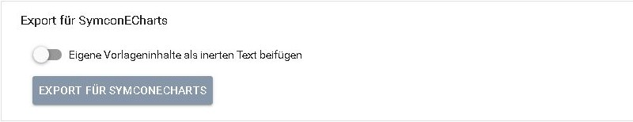

Der eigene Exportbereich in der JSLive-Instanz. Der Schalter für
Vorlageninhalte ist in dieser Aufnahme ausgeschaltet.

Der ältere allgemeine JSLive-Konfigurationsexport ist **kein** Paket dieses
Formats. Eine andere Dateiendung allein wandelt ihn nicht um.
Eigene Vorlagen können als inerte Referenz enthalten sein; ihre Aufnahme in
das Paket macht sie nicht zu ausführbaren ECharts-Vorlagen.

## 2. Paket und Zuordnungen prüfen

1. Im **Symcon-Modulstore** den Eintrag **SymconECharts** installieren
   beziehungsweise aktualisieren und das gemeinsame
   [EChartsGateway](../EChartsGateway/README.md) öffnen.
2. Unter **JSLive-Export und Metadatenprüfung** die Exportdatei auswählen.
   Diese erste Prüfung erzeugt noch keine Instanzen.
3. Bei einer fremden oder nicht bestätigten Installation jede Quelle und jedes
   Archiv ausdrücklich einer vorhandenen ID zuordnen. Namen und Objektpfade
   werden nicht automatisch als Identitätsnachweis verwendet.
4. Fehler zuerst korrigieren. Nach Änderungen an Datei oder Zuordnungen erneut
   prüfen. Die hier angezeigten Zielfamilien sind Kandidaten; maßgeblich ist
   der anschließende vollständige native Übernahmeplan.

Bei numerischen Wertdarstellungen können Legacy-Profile und native
Darstellungen dieselbe Formatierung mit unterschiedlich vielen Standardfeldern
beschreiben. Bekannte Standardwerte und exakt gleiche Integer-/Float-Grenzen
werden bei der Zuordnung als gleichwertig erkannt. Der vollständige Bericht
benennt diese Vergleiche unter `presentationComparisons`. Originalformatierung
und Quelldarstellung bleiben erhalten. Andere Einheiten, Nachkommastellen,
Bereiche, Intervalle oder Aktionen bleiben blockierend; nach Änderungen am
bestätigten Quellstand ist weiterhin ein neuer Plan erforderlich.

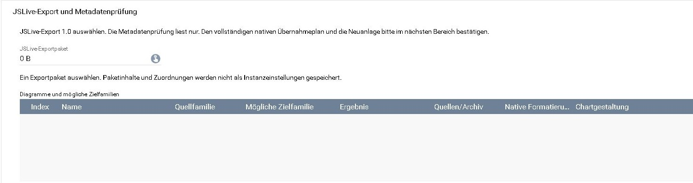

Dateiauswahl und Ergebnisübersicht vor dem Laden eines Pakets. Nach der
Dateiauswahl erscheinen die tatsächlichen Prüfergebnisse und Zuordnungen.

## 3. Vollständigen Übernahmeplan ansehen

1. Unter **Bestätigte JSLive-Übernahme** die Kategorie für neue Instanzen wählen
   (`0` bedeutet Wurzel) und das gewünschte Diagramm auswählen.
2. **Vollständigen nativen Übernahmeplan vorbereiten** ausführen.
3. Den vollständigen Bericht herunterladen. Er enthält für jedes Feld eine
   Übernahme, eine Abweichung oder eine begründete Nichtanwendbarkeit.
4. Die nativen HTML-Vorschauen für Kachel und IPSView ansehen und mit dem
   Original vergleichen. Eine schematische Farbkarte im Formular ersetzt
   diese Ausgabe nicht. Gegebenenfalls Titel, Formatierung, Skalen, Werte,
   Verlauf und Zeitsteuerung gezielt vergleichen.

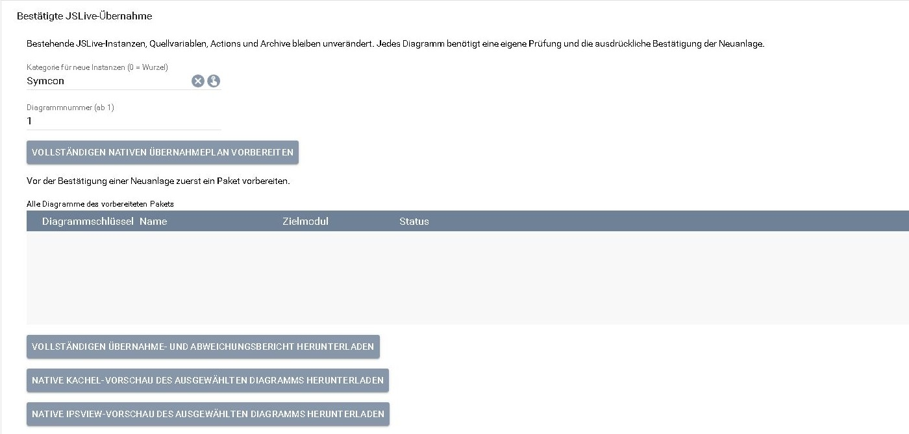

Der Bereich für den vollständigen Plan mit Bericht und beiden Vorschauen.
Die Aufnahme zeigt die Ausgangsansicht ohne vorbereitetes Paket; die
Kategorie steht hier noch auf der Wurzel. Vor dem Vorbereiten die gewünschte
Zielkategorie wählen.

Eine erfolgreiche Paketprüfung beweist weder vollständige Archivabdeckung
noch identisches Rendering. Auch ein gespeicherter Parameter kann in der
JSLive-Quellvorlage ohne sichtbare Wirkung gewesen sein; der Bericht nennt
solche Unterschiede statt sie im Ziel still zu aktivieren.

## 4. Neuanlage ausdrücklich bestätigen

1. Jede angebotene Abweichung einzeln prüfen und akzeptieren.
2. Die **Neuanlage für das ausgewählte Diagramm** ausdrücklich bestätigen.
3. **Ausgewähltes Ziel anlegen oder seinen Journaleintrag sicher fortsetzen**
   ausführen und das Ergebnis samt Ziel-ID im Journal prüfen. Für weitere
   Diagramme die jeweilige Auswahl und Bestätigung wiederholen.

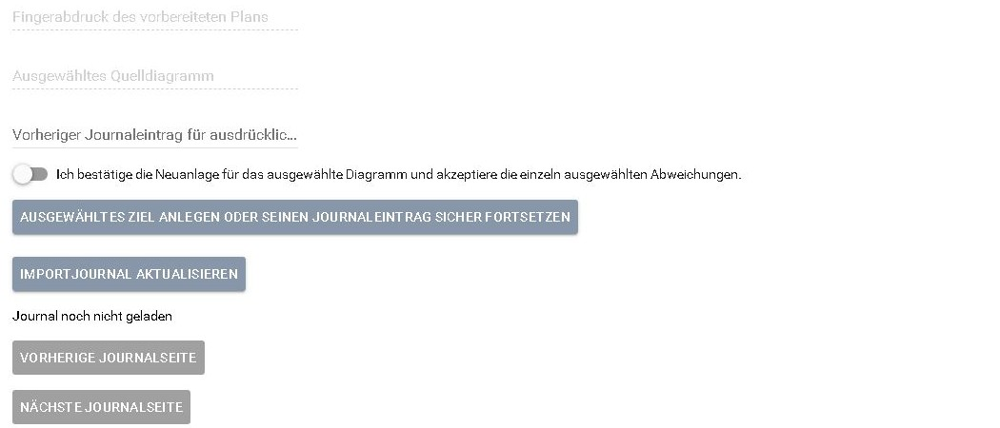

Bestätigungsschalter und Anlageaktion sind von der Planvorbereitung getrennt.
Hier ist noch keine Neuanlage bestätigt und das Journal noch nicht geladen.
Die Formularaufnahmen zeigen die Bedienelemente, keinen ausgeführten Import.

Eine Zustimmung hebt keine Sperre auf. Fehlerhafte Quellen, nicht unterstützte
native Darstellungen, fremde ausführbare Vorlagen, aktive SVG-Inhalte und
überschrittene Schutzgrenzen bleiben abgewiesen. Bestehende Zielinstanzen sind
keine überschreibbaren Importziele.

## 5. Neue Kachel und IPSView einbinden

Die neue Diagramminstanz in einer eigenen Kachel anzeigen. Für IPSView die
HTML-Ausgabe aktivieren und die erzeugte WebContent-Variable verwenden.
Die [Modulanleitung](../README.md#enthaltene-module) nennt ihren Ident und die
verfügbaren Anpassungen. Das Kacheldesign wird standardmäßig geerbt; nach dem
Ausschalten dieser Vererbung kann IPSView unabhängig gestaltet werden.

Original und Ziel zunächst nebeneinander behalten. Neben der Grafik auch
Originalwerte samt Einheit, Archivzeitraum und Datenverarbeitung vergleichen.
Verlaufsanimationen in getrennten Dokumenten haben unabhängige Startphasen.
Eine pixelgleiche Darstellung beliebiger Chart.js-, CanvasGauges- oder
Progressbar-Konfigurationen wird nicht versprochen.

## Vergleichsgalerie: JSLive und ECharts

Die folgenden 14 Aufnahmen hat der Eigentümer am 03.11.2026 aus seiner lokalen
Browseransicht der Testinstallation bereitgestellt. Sie wurden unverändert
übernommen. **Links steht immer JSLive, rechts ECharts.** Die Gruppen lassen
sich einzeln aufklappen; jedes Bild lässt sich für eine größere Ansicht öffnen.

Die Bilder zeigen konkrete übernommene Testmodelle. Sichtbare Unterschiede
etwa bei Achsenteilung, Zahlenformatierung, Schrift, Legenden und Abständen
bleiben erkennbar. Ein Screenshot eines bewegten Verlaufs hält nur eine
Animationsphase fest; getrennte Dokumente laufen nicht phasengleich.

Zeitreihen: mehrere Skalen, Zustände und Neon-Gestaltung (3 Beispiele)

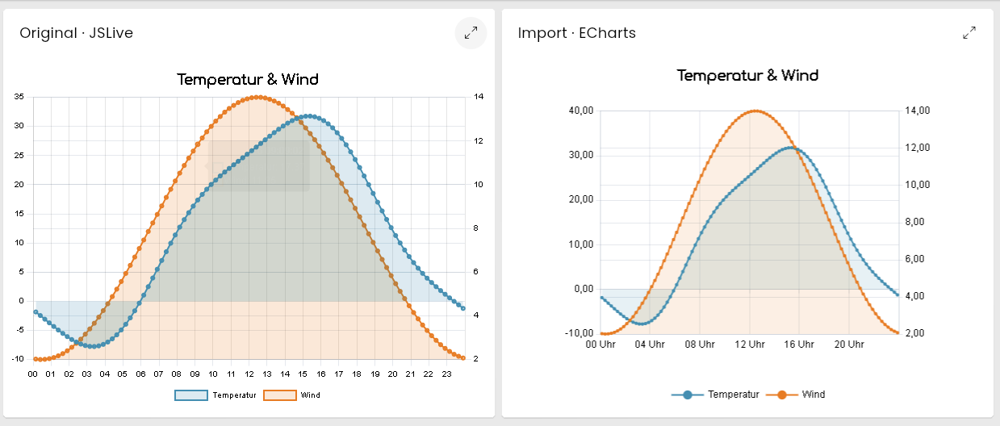

Temperatur und Wind mit zwei Skalen, Messpunkten und Flächenfüllung.

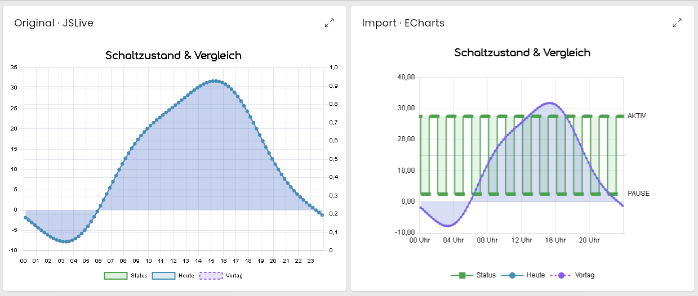

Schaltzustand und Vergleichsreihen. Das Original zeigt in dieser Aufnahme
andere sichtbare Reihen als das Ziel; das Beispiel ist kein Nachweis einer
identischen Reihensichtbarkeit.

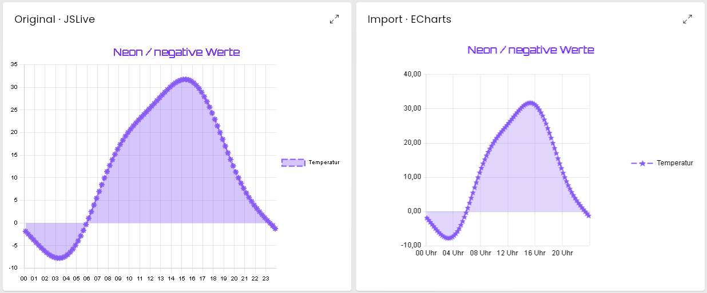

Negative Werte, Sternsymbole, Flächenfüllung und eine seitliche Legende.

Doughnut und historisches Radar (2 Beispiele)

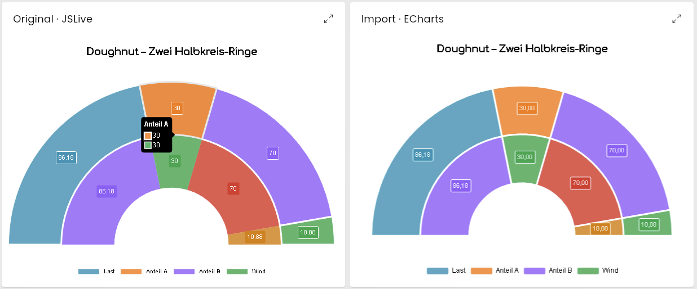

Zwei Halbkreis-Ringe mit Segmentbeschriftungen. Der Tooltip links gehört zum
Aufnahmezustand des Originals.

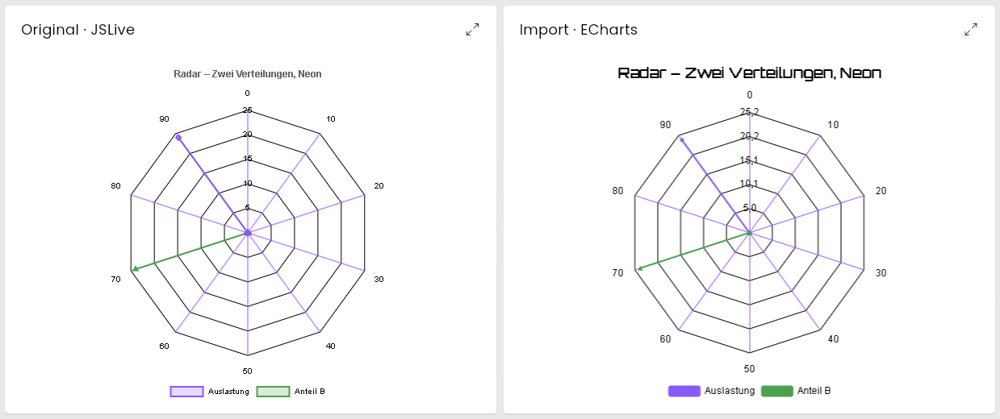

Zwei historische Verteilungen auf gemeinsamen Klassenachsen.

Gauges: radial, Kompass, linear und Neon-Gestaltung (4 Beispiele)

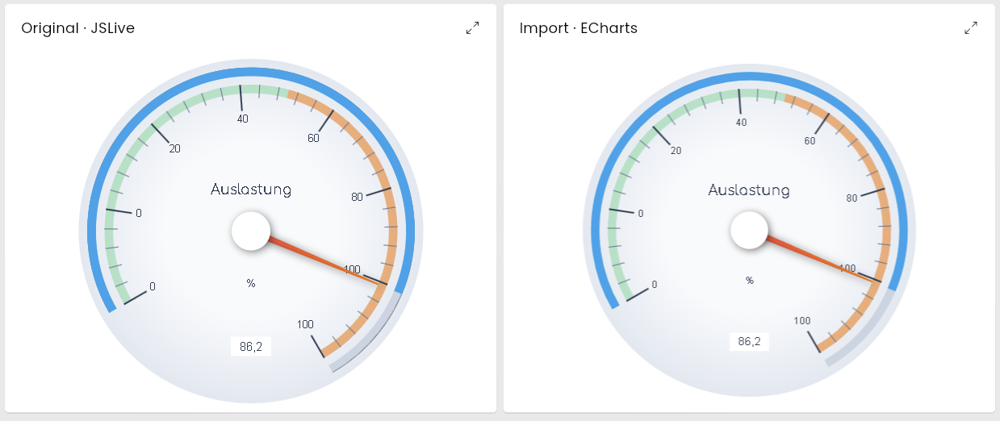

Radiale Auslastungsanzeige mit Fortschrittsring, Skalenbereichen und Zeiger.

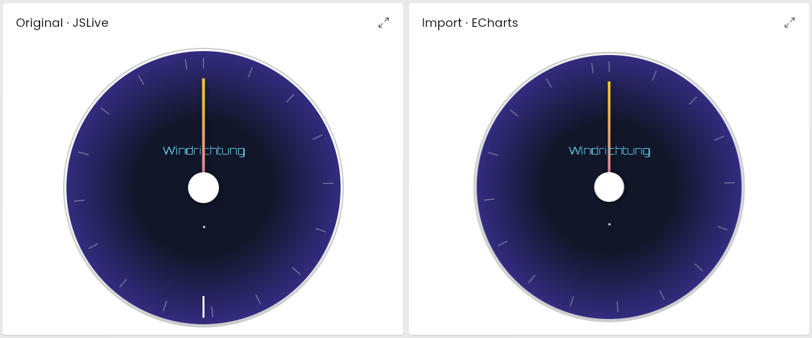

Kompass mit eigener Schrift, Zeiger und dunklem Zifferblatt.

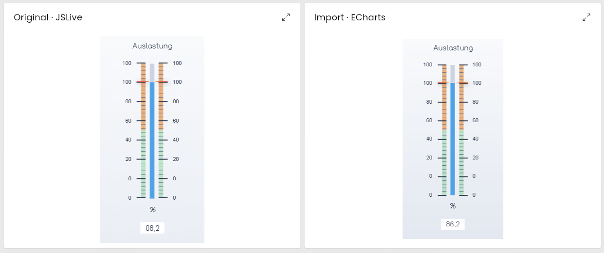

Lineare Auslastungsanzeige mit beidseitigen Skalen.

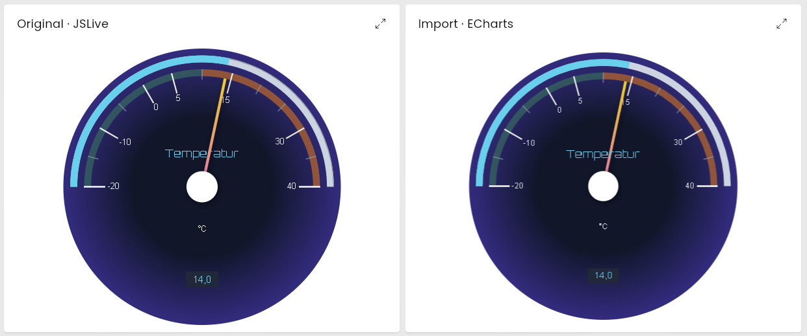

Temperaturanzeige mit negativem Skalenbeginn und eigener Farbgestaltung.

Fortschritt und eigene SVG-Formen (3 Beispiele)

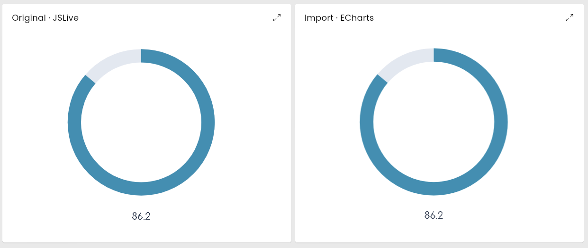

Ringförmiger Fortschritt mit darunterliegendem Originalwert.

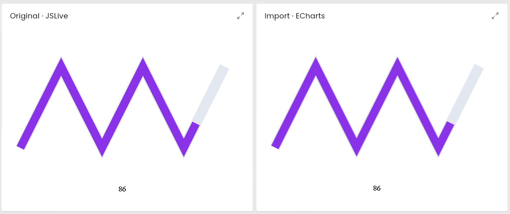

Fortschritt entlang eines eigenen Pfads.

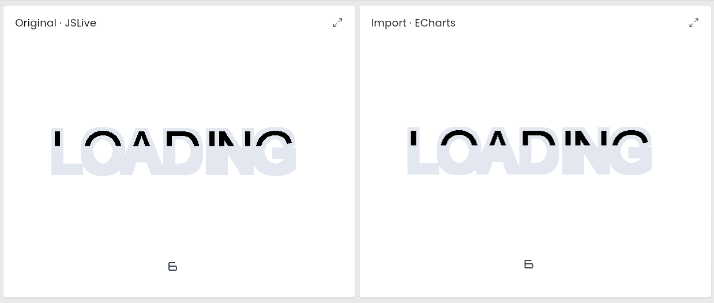

Eine eigene SVG-Schriftform mit Teilfüllung und Zahlenbeschriftung.
Der Schriftzug „LOADING“ ist die dargestellte Form, keine Lademeldung.

Farbverläufe in Fortschrittsanzeige und Gauge (2 Beispiele)

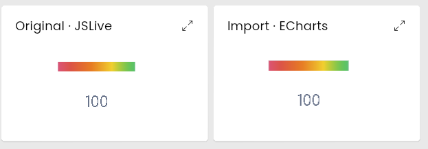

Mehrfarbiger Verlauf innerhalb eines Fortschrittsbalkens.

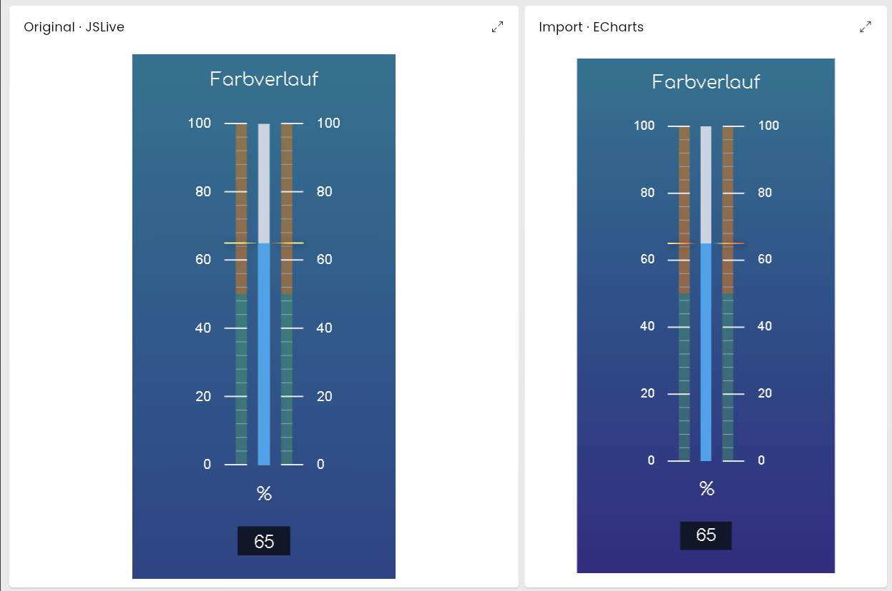

Vertikale Gauge mit gestaltetem Hintergrund und eigener Farbgebung.

## Wiederholung, Unterbrechung und Modulupdates

- **Derselbe gültige Plan:** Eine erneute Bestätigung verwendet das nachgewiesene
  Ziel wieder oder setzt eine unterbrochene Anlage fort. Ein fertiges Ziel wird
  nicht erneut konfiguriert. Eigene zwischenzeitliche Änderungen werden nicht
  durch Importwerte überschrieben.
- **Unterbrochene Anlage:** Datei und Zuordnungen erneut auswählen, den Plan
  vorbereiten und bestätigen. Das Journal nicht zurücksetzen. Bei einer unklaren
  Erzeugung ist eine ausdrückliche Zuordnung erforderlich; das Gateway prüft
  Eigentum und Zielzustand, bevor es fortsetzt. Es erzeugt nicht blind eine Kopie.
- **Modulupdate mit neuen Importregeln:** Einen aktuellen Plan vorbereiten und
  dessen Abweichungen neu bestätigen. Eine alte Bestätigung bleibt gesperrt.
  Bei passendem unverändertem Ziel kann der neue Plan den bisherigen Import
  wiederverwenden; das Journal erhält seine ursprünglichen Nachweise.
- **Geänderter Export oder zusätzliche Kopie:** Eine getrennte Neuanlage mit
  dem passenden bisherigen Journaleintrag als Ausgangspunkt wählen. Das alte
  Ziel bleibt erhalten. Ein neuer Export aktualisiert kein vorhandenes Design.

Die Formularansicht zeigt bis zu 25 Journaleinträge je Seite. Bei Änderungen
während des Blätterns **Importjournal aktualisieren** wählen. Die
[Gateway-Befehlsreferenz](../EChartsGateway/README.md#7-php-befehlsreferenz)
beschreibt auch den paginierten Abruf per PHP.

## Grenzen und nicht übertragbare Inhalte

Pakete bleiben auf 16 MiB, 100000 JSON-Werte und 32 Ebenen begrenzt. Der
vollständige Bericht umfasst höchstens 8 MiB; er wird nicht still gekürzt.
Das Journal hält höchstens 1000 Einträge und 4 MiB. Für große Bestände kleinere
Pakete verwenden. Zusätzlich gelten die jeweiligen Modell-, Ressourcen-,
Archiv- und Ausgabegrenzen.

Ressourcen stammen aus dem geprüften Paket und werden lokal verwendet.
Externe Bildadressen werden nicht nachgeladen; fremde Skripte und eigene
ausführbare Templates werden nicht ausgeführt. Nicht unterstützte Effekte,
Schatten, Schrift- oder Timingunterschiede werden im Übernahmebericht sichtbar
gemacht. Originale und Exportdatei deshalb behalten, bis die neue Darstellung
für den eigenen Anwendungsfall geprüft ist.

[Zur Bibliotheksübersicht](../README.md) ·
[Konfigurationsreferenz](KONFIGURATION.md#übernommene-jslive-modelle)
